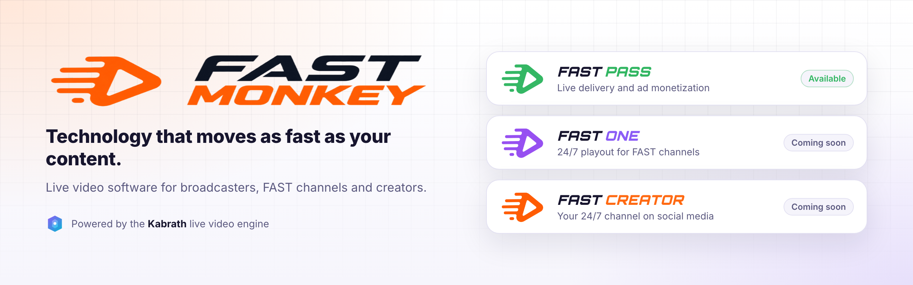
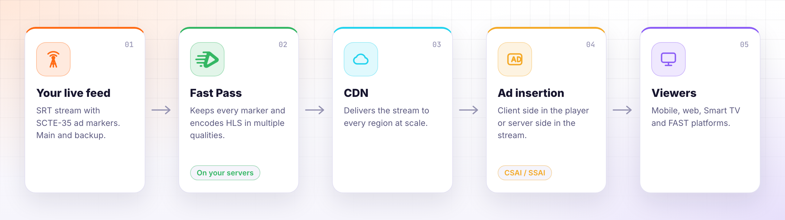

<picture>
  <source media="(prefers-color-scheme: dark)" srcset="assets/banner-dark.png">
  
</picture>

  
  
  
  

## Who we are

We build live video software for **TV broadcasters**, **FAST channels** and **content creators**.

Every Fast Monkey product runs on **Kabrath**, our live video engine. Our products all share the same proven core:
reliable live ingest, adaptive streaming for every screen and ad markers that turn every break into revenue.
Each product then adds the screens and workflow its users need.

 

## Our products

<table>
  <tr>
    <td width="33%" valign="top">
       
      <h3>Fast Pass</h3>
        
      <b>Live delivery and ad monetization.</b> 
      Already have a feed with SCTE-35 markers? Fast Pass ingests your stream, keeps every marker and delivers
      adaptive HLS to the world, ready for client side or server side ad insertion.
      <ul>
        <li>SCTE-35 passthrough</li>
        <li>Adaptive HLS for every screen</li>
        <li>Main and backup feeds with automatic failover</li>
      </ul>
    </td>
    <td width="33%" valign="top">
       
      <h3>Fast One</h3>
        
      <b>Enterprise playout for 24/7 FAST channels.</b> 
      Schedule your library and live events into a channel that never stops, with the ad breaks,
      graphics and guide data FAST platforms expect.
      <ul>
        <li>24/7 playout</li>
        <li>SCTE-35, logo, slate and alerts</li>
        <li>EPG and object storage integration</li>
      </ul>
    </td>
    <td width="33%" valign="top">
       
      <h3>Fast Creator</h3>
        
      <b>Your 24/7 TV channel on social media.</b> 
      Turn your video library into round the clock programming, take over with your live feed whenever
      you go on air and keep your audience all day long.
      <ul>
        <li>VoD schedule plus live</li>
        <li>SCTE-35 ad breaks</li>
        <li>Several platforms at once</li>
      </ul>
    </td>
  </tr>
</table>

 

## How Fast Pass works

From your feed to the viewer, with no playout and no reprocessing of your content.

<picture>
  <source media="(prefers-color-scheme: dark)" srcset="assets/how-it-works-dark.png">
  
</picture>

The SCTE-35 markers in your feed become ads on mobile, web and Smart TV. Choose the insertion model that fits
your distribution: **CSAI**, where the player fetches the ad from your ad server, or **SSAI**, where the ad is
stitched into the stream for a seamless, TV like transition on any player.

 

## Why teams choose Fast Monkey

<table>
  <tr>
    <td width="50%" valign="top">
       
      <b>Runs on your infrastructure</b> 
      One installer sets up the whole stack on your own server in minutes. Your content stays under your control.
    </td>
    <td width="50%" valign="top">
       
      <b>Every break becomes revenue</b> 
      Ad markers from your feed reach the stream intact, on every quality, ready for your ad server.
    </td>
  </tr>
  <tr>
    <td width="50%" valign="top">
       
      <b>Built for 24/7</b> 
      Main and backup feeds, automatic failover, and a channel that comes back on its own after a restart.
    </td>
    <td width="50%" valign="top">
       
      <b>Broadcast grade monitoring</b> 
      Alerts, availability timeline, loudness to EBU R128 or ATSC A/85 and a full SCTE-35 event log.
    </td>
  </tr>
  <tr>
    <td width="50%" valign="top">
       
      <b>Ready for every screen</b> 
      Adaptive HLS for mobile, web, Smart TV and FAST platforms, delivered through your CDN.
    </td>
    <td width="50%" valign="top">
       
      <b>Simple licensing</b> 
      One license per channel, activated in seconds from the control panel.
    </td>
  </tr>
</table>

 

   
  <b>Fast Monkey</b> products are powered by the <b>Kabrath</b> live video engine.

